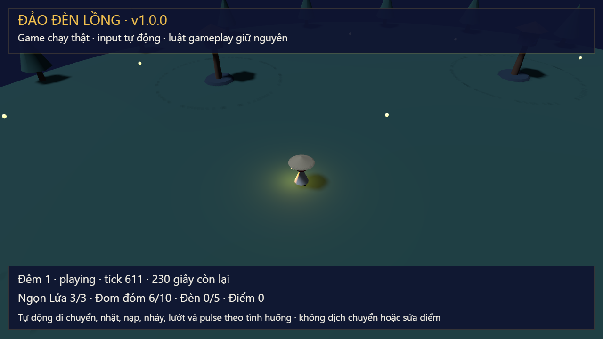
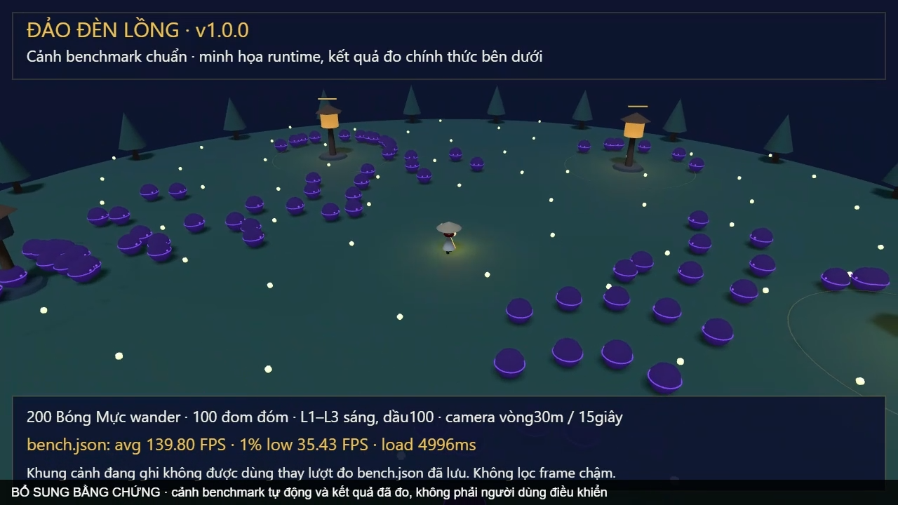

# Đảo Đèn Lồng · v1.0.0

Game web 3D qua ba Đêm: thu thập đom đóm, duy trì đèn và tránh Bóng Mực để sống tới bình minh. Phase 4 dùng **Contract v1.3**, giữ luật gameplay Phase 3, bổ sung bảng điểm cục bộ, đổi phím, dễ tiếp cận và công cụ đo hiệu năng.



Ảnh lấy từ game đang chạy. [Video demo bàn giao](https://github.com/vumanhhoach2003/K5-L3A-DAY12-VuManhHoach-2A202603500-AI-SDLC-Dao-Den-Long/releases/download/v1.0.0/demo.mp4) dài **3 phút 55 giây**, gồm video người dùng chơi thực tế (191,27 giây), tiếp theo là bằng chứng test/benchmark có nhãn nguồn. [Metadata bản gốc](docs/demo/manual/metadata.json), [metadata video cuối](docs/demo/final/metadata.json) và [video tự động nguồn](docs/demo/demo-auto.mp4) được ghi rõ riêng. Tải gói tại [Release v1.0.0](https://github.com/vumanhhoach2003/K5-L3A-DAY12-VuManhHoach-2A202603500-AI-SDLC-Dao-Den-Long/releases/tag/v1.0.0).

## Chạy từ nguồn

Cần Node.js **22+**, npm, trình duyệt hỗ trợ WebGL2 và GPU tăng tốc. Đã kiểm chứng trên Windows 11 x64, Node 26.13.1, Brave/Chromium. Các đường dẫn CLI tương thích Windows/macOS/Linux; chưa đo GPU trên hai hệ điều hành sau. Không cần CDN hoặc tài khoản.

Trong thư mục repo sau khi clone:

```sh
npm ci
npm run build
npm start
```

Nếu PowerShell chặn `npm.ps1`, dùng `npm.cmd` thay `npm` trong ba lệnh trên, hoặc dùng Command Prompt; không cần đổi execution policy.

Mở **http://127.0.0.1:4173/**. Dùng Ctrl+F5 nếu còn trang cũ. Ba lệnh trên đã được thử trong thư mục nguồn sạch, không có node_modules/dist từ phiên phát triển: [báo cáo](docs/proof/phase-4/clean-checkout.json).

Bản ZIP phát hành chứa sẵn `dist/` và Node runner: giải nén, chạy `node scripts/run.mjs` tại thư mục gói, rồi mở địa chỉ trên. Không cần npm install cho cách này. Có thể phục vụ riêng `dist/` bằng static hosting; khi đó bảng điểm dùng localStorage của trình duyệt. Chạy bằng Node runner để lưu điểm thành file trên đĩa và xuất bằng CLI. Không mở HTML bằng file://.

## Chơi và cài đặt

| Mặc định | Hành động |
| --- | --- |
| WASD | Di chuyển theo camera |
| Space / Shift trái | Nhảy / lướt |
| E | Nạp, thắp lại hoặc châm dầu |
| Q | Tỏa Sáng, tốn 3 đom đóm |
| P / Esc | Tạm dừng và mở cài đặt |
| Kéo chuột hoặc ← / → | Xoay camera |
| R | Chơi lại Đêm |

Có thể đổi riêng cả 9 hành động trong Cài đặt; phím trùng bị từ chối, có khôi phục mặc định. Các phím tắt R/Esc và camera vẫn hoạt động khi không được gán cho hành động khác. Cài đặt âm lượng, độ nhạy, bảng màu dễ phân biệt, giảm chuyển động và chữ lớn ×1,25 được lưu theo trình duyệt. UI dùng chữ tối thiểu 18px. Phụ đề/cảnh báo hình ảnh báo địch xuất hiện kèm mũi tên mép màn hình, gió sắp tới, 10 giây cuối và đèn dưới 30 dầu. Âm thanh bắt đầu sau thao tác vào Đêm.

Đêm 1/2/3 dài 240/270/300 giây; tại bình minh cần 3/5, 4/6, 5/7 đèn sáng. Thắp đủ sớm vẫn tiếp tục chơi. Đèn hao 1 dầu/giây; E châm thêm 10 dầu mỗi đom đóm, tối đa 100. Đèn dưới 30 dầu mất vùng an toàn; Bóng Mực có thể hút đèn yếu. Thắp lần đầu cần 10 con, thắp lại cần 5. Xem [luật chi tiết Phase 3](docs/phase-3-README.md) và [ADR về dầu/thứ tự tick](docs/adr/003-lantern-fuel-and-dawn.md).

Sau khi thua hoặc thắng Đêm 3, nhập tên 3–12 ký tự `[A-Za-z0-9_]` để lưu tổng điểm **các Đêm đã thắng**. Menu Bảng xếp hạng giữ top 10, điểm giảm dần, hòa thì thời điểm đạt trước đứng trên. Node runner lưu `data/leaderboard.json`; có thể đặt thư mục riêng bằng biến môi trường `LANTERN_DATA_DIR`. Điểm người dùng không được commit.

```sh
node scripts/run.mjs --export-leaderboard out.json
```

## Kiểm thử và headless

```sh
npm test
npm run verify
node src/headless.mjs --seed 42 --night 1 --scenario tests/scenarios/phase-3/relight-at-expiry.json --inputs tests/scenarios/phase-3/relight-at-expiry.inputs.json --ticks 60 --out result.jsonl --snapshot-every 10
```

64 test và 42 scenario được kiểm chứng; mỗi scenario chạy hai lần so byte, đối chiếu kỳ vọng và hash với Phase 3. [Bằng chứng](docs/proof/phase-4/verification.json). Headless cố định 60 tick/giây, không renderer; thời gian chạy headless không phải FPS. `verify` kiểm tra thêm ngưỡng của các file benchmark/soak đã đo; không tự chạy lại GPU. Chưa có kết quả test ẩn của giảng viên.

DOM smoke riêng: `node scripts/ui-smoke.mjs`, dùng profile và bảng điểm tạm; 17 kiểm tra đạt. Viewport headless thực tế 1262×574 được ghi trong [báo cáo UI](docs/proof/phase-4/ui-smoke.json), không nhận là phép đo GPU hoặc kiểm chứng mọi bố cục.

## Benchmark và soak

```sh
npm run bench -- --seed 42 --duration 30 --out bench.json
npm run soak -- --seed 7 --nights 10 --out soak.json
```

Benchmark mở Chromium riêng, cảnh chuẩn 1280×720: 200 Bóng Mực wander, 100 đom đóm, L1–L3 sáng với 100 dầu; tắt spawn/hit/pickup/decay/end, Mây đứng tại gốc. Camera bán kính 30m, cao 15m, một vòng 15 giây; warmup 3 giây rồi đo đúng 30 giây. CLI tự thoát và lưu `benchmark.png`. Đặt `LANTERN_BROWSER` tới executable Chromium/Chrome/Edge/Brave nếu không tự tìm được. Không dùng hồ sơ trình duyệt cá nhân.



| Số đo trên máy phát triển | Kết quả | Ngưỡng |
| --- | --- | --- |
| FPS trung bình | 139,8 | ≥60 |
| 1% low FPS | 35,43 | ≥30 |
| p95 thời gian frame | 7,10 ms | Báo cáo |
| Tải đến frame đầu | 4995,88 ms | ≤10000 ms |
| Frame trong 30 giây | 4194 | Báo cáo |
| Soak 10 Đêm / crash | 10 / 0 | 0 crash |
| RSS đầu → cuối | 44,08 → 47,34 MB (+7,38%) | ≤20% tăng |

Raw: [bench.json](bench.json), [soak.json](soak.json). OS Windows 10.0.26200 x64; Three.js 0.181.2/WebGL2. Đây là số tham khảo; ngưỡng chính thức được chấm lại trên máy giảng viên công bố. Web requestAnimationFrame không bảo đảm tắt vsync, nên `vsync_off:false`. Không có RSS trình duyệt đáng tin qua API web, nên `peak_mem_mb:null`.

Soak chạy cùng một tiến trình, Đêm 1→2→3 xoay vòng, seed 7…16, input theo xác suất contract. Lệnh npm ghi rõ V8 `--jitless --expose-gc --max-semi-space-size=1 --max-old-space-size=64`: GC sau tải Đêm đầu và sau reset cuối, không tăng giả baseline. File JSON lưu flags và cách đo. Mười lượt này đều thua với input ngẫu nhiên, không phải bằng chứng chơi thắng. [Ghi chép](docs/notes/phase-4.md) giữ cả các lần đo chưa đạt trước tối ưu.

## Tài liệu bàn giao

[Ticket Phase 4](docs/spec/ticket_04_phase_4.md) · [Nghiệm thu](docs/spec/phase-4-acceptance.md) · [Changelog bốn phase](CHANGELOG.md) · [Retro](docs/retro.md) · [AGENTS](AGENTS.md) · [Credits](CREDITS.md) · [License](LICENSE).

Giữ cảnh biển mây, sao, nhân vật, lời Ông Đăng và âm thanh thủ tục trong lúc chơi; cảnh benchmark tắt các phần trang trí sáng tạo theo ticket. Các tag Phase 1–3 được giữ nguyên. [README Phase 1](docs/phase-1-README.md), [Phase 2](docs/phase-2-README.md), [Phase 3](docs/phase-3-README.md) là tài liệu lịch sử, không phải trạng thái phát hành hiện tại.
